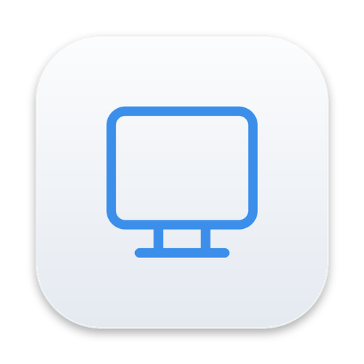

<div align="center">



# CrossTerm

**Everything you need to manage remote servers, in one native app.**<br>
A tabbed terminal with SSH, SFTP, Mosh, RDP, VNC, FTP and more: C++17 and Qt, no web engine.


[⬇️ Download](#️-download) · [✨ Features](#-features) · [📥 Importing sessions](#-importing-sessions) · [🛠️ Building](#️-building) · [🧪 Tests](#-tests)

</div>

---

## ⬇️ Download

Get the latest version from [**Releases**](../../releases/latest):

| System | File | Notes |
| --- | --- | --- |
| 🪟 **Windows** | `CrossTerm-<version>-Windows-Setup.exe` | Installer with the integrated X server (VcXsrv) |
| 🐧 **Linux** | `CrossTerm-<version>-x86_64.AppImage` | Qt bundled, glibc 2.35 or newer |
| 🍎 **macOS** | `CrossTerm-<version>-macOS.dmg` | Universal app (Apple Silicon and Intel) |

> [!TIP]
> **Portable mode:** create an empty `CrossTerm.portable` file next to `CrossTerm.exe`, or start with `--portable`. Settings and sessions go to `CrossTerm-data`.

---

## ✨ Features

### 🖥️ Sessions and terminal
- **Sessions in tabs**: SSH, Telnet, Rlogin, Rsh, serial, Mosh (native, with local echo prediction), VNC (native RFB client), FTP/FTPS (built-in browser), RDP (embedded on Windows and Linux) and WSL.
- **Split view** with draggable separators and **MultiExec**.
- **Terminal**: reflow on resize, scrollback, search (<kbd>Ctrl</kbd>+<kbd>Shift</kbd>+<kbd>F</kbd>), output saving, automatic session logging, color schemes.

### 🔐 SSH and passwords
- Keys, agent, jump hosts, compression, keepalive, HTTP/SOCKS proxy (CrossTerm acts as ProxyCommand).
- **X11 forwarding** with the integrated X server (VcXsrv in `dist\xserver`, started on demand) and XDMCP.
- Passwords stored in the **system vault** (Windows Credential Manager, macOS Keychain, Linux Secret Service), never in the sessions file or on the command line. OpenSSH receives them from CrossTerm acting as SSH_ASKPASS.
- Password and host-key prompts appear **inside the SSH terminal**, without dialogs. A password typed there once is kept in memory and reused by SFTP, remote monitoring, tunnels and Mosh, which connect on their own as soon as the terminal logs in.

### 📂 SFTP browser
- Upload and download, **transfer queue** with resume, speed and time left.
- Drag and drop to and from the desktop, remote editing with automatic upload, recursive delete.
- 🗜️ **Archives**: compress, *Extract here* and *Extract and delete* for zip, tar, rar and 7z, with a progress bar.
- 📁 New folder and rename in place in the list; file icons from the system.
- **Follow terminal folder**.

### 🔄 Sync between devices
Sessions, folders, favorites, tunnels, macros and, if chosen, saved passwords and SSH private keys, **end-to-end encrypted on the device** (XChaCha20-Poly1305, key from a sync password with Argon2id, recovery key).

Where: a synced folder (iCloud Drive, Proton Drive, Syncthing...), Dropbox, OneDrive, Google Drive, WebDAV, SFTP, FTPS or a secret GitHub Gist. Changes are merged record by record; one edited on two devices keeps both versions.

### 🧰 Tools
- 🚇 **SSH tunnels**: local (`-L`), remote (`-R`) and dynamic SOCKS (`-D`), optionally started with CrossTerm.
- 📊 **Remote monitoring**: CPU, RAM, network, uptime, user and disk bar under the terminal.
- 🌐 Built-in **HTTP, TFTP and FTP/FTPS servers**, port scanner.
- Macros, favorites, session recovery, sessions opened at startup, configurable keyboard shortcuts.
- ♻️ Every process CrossTerm starts (shells, ssh, sftp, tunnels, X server) ends with it, also after a crash.

### 🎨 Appearance and languages
- **macOS** or **Classic** style, light, dark or following the system (default: macOS following the system), switched live from Settings > Configuration > Theme.
- <kbd>Ctrl</kbd> + mouse wheel zooms the terminal font.
- 🌍 **30 languages** with live switching and right-to-left layouts. The window reopens at its last position and size, fitted to the monitor work area.

---

## 📥 Importing sessions

**Sessions > Import** reads session files from:

`MobaXterm` (MobaXterm.ini, .mxtsessions, .mobaconf) · `SecureCRT` · `Exceed` · `PuTTY` · `mRemoteNG` · `PuTTYCM` · `SuperPuTTY` · `WSL` · `CSV` (name, host, port, user, protocol, folder)

- 👀 Preview with duplicates; choose Skip, Merge or Replace.
- 💾 Backup copy and **"Undo last import"**.
- Macros, tunnels and preferences can be imported too. Source files are only read, never modified.

> [!NOTE]
> Passwords protected by the source application are not decrypted: CrossTerm imports the account user names and asks for each password once, then stores it in the system vault.

---

## 🛠️ Building

Requires **Qt 6.5+**, **CMake 3.21+** and a **C++17** compiler. Ready-made scripts in `scripts/` build in Release, run the tests and package the result; each one lists its dependencies at the top.

| Platform | Command | Output |
| --- | --- | --- |
| 🪟 Windows (MSVC) | `powershell -ExecutionPolicy Bypass -File scripts\build-windows.ps1 -Qt C:\Qt\6.8.3\msvc2022_64` | `dist\CrossTerm.exe` with the Qt DLLs (windeployqt); installer `build\CrossTerm-<version>-Windows-Setup.exe` when Inno Setup 6 is installed |
| 🐧 Linux | `sh scripts/build-linux.sh` | `build/CrossTerm` |
| 🐧 Linux (AppImage) | `sh scripts/build-appimage.sh` | `build/CrossTerm-<version>-x86_64.AppImage` with Qt bundled (linuxdeploy) |
| 🍎 macOS | `sh scripts/build-macos.sh` | `build/CrossTerm.app` with Qt bundled (macdeployqt) and `build/CrossTerm-<version>-macOS.dmg` |

<details>
<summary><b>🔧 Manual build</b></summary>

```sh
cmake -S . -B build -DCMAKE_PREFIX_PATH=/path/to/Qt
cmake --build build --config Release
ctest --test-dir build -C Release --output-on-failure
```

For the integrated X server on Windows, put the VcXsrv files in `dist\xserver` (GPL v3, see its license).
</details>

<details>
<summary><b>🚀 Release builds</b></summary>

Pushing a tag `v<version>` (matching `project(VERSION)` in CMakeLists.txt) runs `.github/workflows/release.yml`. It builds the Windows installer (with VcXsrv), the Linux AppImage and the macOS `.dmg`, and attaches them to a draft GitHub release; then publish the draft.

The `.dmg` built in CI is signed ad hoc: other Macs open it the first time with right click > Open. A Developer ID signed and notarized `.dmg` is built on a Mac with `scripts/build-macos.sh` and replaces it in the draft.
</details>

<details>
<summary><b>☁️ App ids for cloud sync</b></summary>

Signing in to Dropbox, OneDrive and Google Drive needs the app ids registered with each service, given at configure time as CMake variables or environment variables:

| Variable | Notes |
| --- | --- |
| `CROSSTERM_DROPBOX_APP_KEY` | redirect URIs `http://localhost:53682/`, `http://localhost:53683/`, `http://localhost:53684/` |
| `CROSSTERM_MICROSOFT_CLIENT_ID` | public client, redirect URI `http://localhost` |
| `CROSSTERM_GOOGLE_CLIENT_ID` and `CROSSTERM_GOOGLE_CLIENT_SECRET` | Desktop app client |

The release workflow reads them from repository variables; a missing one leaves that service out.
</details>

> [!WARNING]
> The Linux build has not been verified on Linux yet.

---

## 🌍 Translations

Catalogs live in `i18n/*.json`. After changing user-visible strings run `python i18n/extract.py` and update the catalogs: the `profiles` test fails if a key is missing from any language.

---

## 🧪 Tests

- 📁 Sources are in `src\`; tests in `tests\`.
- `tests\test.cpp` and `tests\test_*.cpp`: one executable per area, collected by CTest.
- `CrossTerm.exe --smoke-test`: local terminal, Tab and focus.
- `CrossTerm.exe --config <sessions.json> --e2e <folder>`: end-to-end run against a test SSH/SFTP server (first profile, key authentication). It saves screenshots and `e2e.txt` in the folder.

UI tests open the window off screen without activating it, so they never steal focus.

📋 The status of each feature is in [FEATURES.md](FEATURES.md). Tested on Windows and macOS; the Linux build still needs verification.

---

## 📦 Third-party components

<details>
<summary>Details</summary>

- The local terminal uses **ConPTY** on Windows and **forkpty** on Linux and macOS.
- Terminal emulation is handled by **libvterm** (revision `934bc2fbf21800ac3458a499df8820ca5fb45fd3`, license in `vendor/libvterm/LICENSE`). The vendored copy carries local changes; keep them when updating it:
  - four fixes in `src/screen.c` and `src/state.c`: resize of wrapped lines and of a shrunk scroll region, repeat of a combining character, no `abort()` on resize;
  - the faint attribute (SGR 2, `VTERM_ATTR_DIM`), in `include/vterm.h`, `src/pen.c`, `src/screen.c`, `src/vterm.c` and `src/vterm_internal.h`.
- The encrypted sync file (`src/syncvault.cpp`) uses **Monocypher 4.0.3**, unmodified (XChaCha20-Poly1305 and Argon2id; BSD-2 or CC0, license in `vendor/monocypher/LICENCE.md`).
</details>

<div align="center">

Made with ❤️ in C++17 and Qt

</div>
